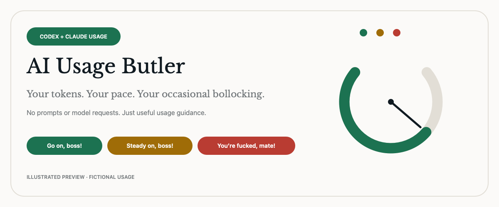
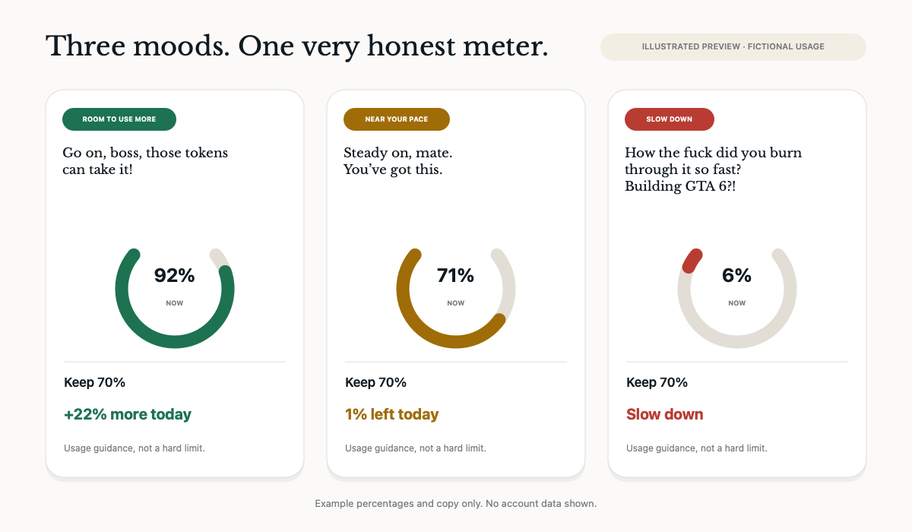

# AI Usage Butler



Your tokens. Your pace. Your occasional bollocking.

Usage guidance for Codex and Claude Code, with fifty rotating one-liners for when the meter has opinions. The joke is extra. The pacing advice stays clear.

## Three moods



The percentages and copy in these illustrations are fictional examples. They are not screenshots and do not show anyone's account data.

- See remaining weekly and session usage for each provider.
- Get pace guidance toward the next 07:00 target, with a 22:00 bedtime and an overnight reserve when needed.
- Keep the useful instruction visible under the banter. Missing or stale readings do not get a roast.
- Refresh manually, enable optional usage alerts, or launch at login.

Usage pacing is guidance, not a guarantee against reaching a provider limit. Session percentages are separate from weekly percentages and may constrain use sooner.

## Requirements

- macOS 14 or later. The optional package command targets Apple Silicon and Intel Macs.
- Swift 5.9 or later from Xcode or the Xcode Command Line Tools to build from source.
- Codex installed and signed in to read Codex usage. The app looks for the Codex CLI at `~/.local/bin/codex`, `/opt/homebrew/bin/codex`, or `/usr/local/bin/codex` and runs its local `app-server` command.
- Claude Code installed and signed in to read Claude usage. The first interactive connection may show a macOS Keychain access prompt for Claude Code's existing credential.

Either provider can be unavailable. The app shows that state without inventing usage values.

## Privacy

Usage Butler does not send prompts, chat history, files, or generated content to an AI model. It does not make model-inference requests, generate AI content, or include telemetry or analytics.

Codex usage is read from the local Codex app-server. Claude usage is fetched from Anthropic's usage endpoint. Usage Butler reads Claude Code's existing OAuth credential from macOS Keychain and sends it only as authentication for that usage check. The credential is not bundled with the app. The usage request contains no prompts or conversations. Usage results and a SHA-256 credential fingerprint are cached locally in the app's UserDefaults to reuse recent results and detect sign-in changes.

Claude's usage endpoint is not a stable public API and may change. Claude may rate-limit checks; the last successful result is marked stale after 15 minutes. Automatic refresh runs every five minutes. A successful Claude result is reused for five minutes, including on manual refresh and relaunch. Details shows when it was fetched. `./script/build_and_run.sh --diagnose` prints usage readings or errors as JSON, not the credential.

## Build and run

Run `swift test` to run the tests. To build and launch a local copy on a Mac:

```sh
git clone https://github.com/tibinta/ai-usage-butler.git
cd ai-usage-butler
./script/build_and_run.sh
```

To prepare a universal release archive for Apple Silicon and Intel Macs running macOS 14 or later, run `./script/build_and_run.sh --package`. It creates `dist/AI Usage Butler-1.0.0-universal-macOS14.zip` and a `.sha256` checksum file without launching or replacing the development app. The archive uses an ad-hoc signature by default and is not notarized, so macOS may show a first-open security warning. Setting `CODE_SIGN_IDENTITY` uses that identity with the hardened runtime and timestamp, but does not notarize the app.

Launch at login is optional and uses macOS Service Management. Changing it modifies only that macOS preference. The included Libre Baskerville font is distributed under its accompanying OFL license.

## Project status

This is a personal project, maintained for the author's own use and shared as-is. There is no promised support, response time, compatibility, or update schedule. Updates may be shared when useful to the author; installed copies do not update automatically. Each user supplies their own provider sign-ins. No account credentials or personal usage data are included in the source or release packages.
